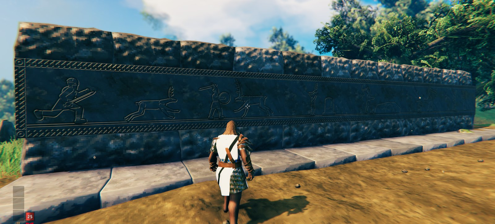
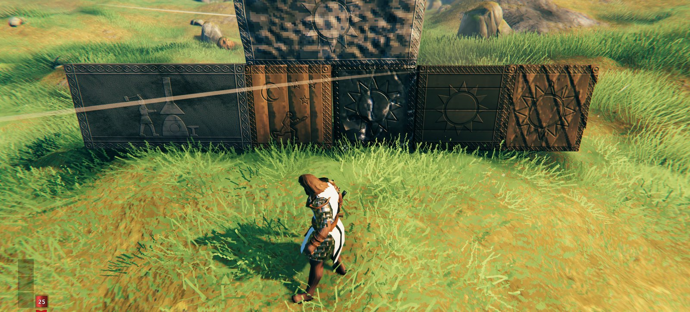

# Engraving

Carve Norse engravings into your walls. Describe the carving in plain words (or pick from dropdowns) and the chisel
cuts it into the wood or stone: knotwork and rune borders, suns and valknuts, Vikings and creatures in poses of your
choosing, your own pictures, and scenes from your own journey.

```
background recessed
border all: runes "here feasted the sons of Hippo"
left: a viking toasting, holding a drinking horn
right: a shieldmaiden holding a sword and a shield, facing left
```





**This is an early beta.** Back up your world before trying it, and expect carvings to look a little different as
the mod improves.

## Features

- **A chisel** (workbench: 2 wood, 4 flint). Equip it, look at a wall and press **E** (Shift+E on doors and gates).
  Each side of a piece can carry its own carving. Carving wears the chisel.
- **Three ways to carve.** *Basic* builds a carving from dropdowns. *Scene* carves a scene from your journey.
  *Advanced* is the carving language itself, for anything more. A live preview shows the result as you go.
- **Borders**: knotwork, ring-chain, runes (Elder Futhark, from your own text), lines, beads, zigzag.
- **Shapes**: sun, stars, crescent, valknut, triskele, crosses, heart, arrow and more, in rows, rings and grids.
- **Figures**: Vikings, shieldmaidens, Odin and over 50 creatures, from boars to the Queen, each in poses (striking,
  running, howling, flying, toasting...). People can hold axes, swords, spears, shields, bows, drinking horns and more.
- **Scenes from your journey**: `a scene of war`, `hunting`, `gathering`, `victory` or `progress` carves you (a Viking
  or shieldmaiden, as your character is) against the furthest foe whose trophy you've taken, the prey you've hunted,
  the ore you've mined, the last Forsaken you beat, or the crafting station you've built. Carve a hallway as you play.
- **Your own pictures**: PNG silhouettes in `Documents\ValheimEngraving\Engravings`. Other players see them too: the
  server's pictures arrive automatically, other players' only when you approve them (`engrave_pending`, `engrave_get`).
- Carvings match the wall they're cut into: every vanilla wood and stone wall, including grausten and black marble.

## Installation

Use a mod manager (r2modman, Thunderstore Mod Manager), or by hand: install BepInExPack Valheim and Jötunn, then put
`Engraving.dll` in `BepInEx\plugins`.

Multiplayer: install it on the server too. Players without the mod can still join (they just don't see carvings);
players with it must run the same version (to the minor number). The server decides which pieces are carvable and
how fast chisels wear.

## Configuration

`BepInEx\config\com.hippoflotomas.engraving.cfg`:

- **Pieces / CarvablePieces**: which build pieces can be carved (prefab names; `engrave_inspect` shows a piece's name).
  Set by the server.
- **Chisel / Durability, WearPerCarving**. Set by the server.
- **Rendering**: texture resolution, carve depth, colour texture size, wall bumps.
- **Pictures / Server**: picture folders and sharing limits.

Your own poses: JSON files in `Documents\ValheimEngraving\EngravingPoses` (an example file with every built-in pose
is written there). `engrave_reload` re-reads pictures and poses.

## The carving language

One line per part of the carving: `background ...`, `border <sides>: ...`, then the charges with where they go
(`center:`, `top left:`, ...). The full guide is at the GitHub link below (docs/LANGUAGE.md).

## Known issues

- Some figures are still rough: the stone golem, perched birds, the insects, the seal, the Neck, Bonemass.
- Not every creature has a figure yet (Fader, Elaking, mole, Writhan and others); their trophies don't appear in scenes.
- Plain doors carve well (wood door, wood gate, shutter). Decorated doors (dark wood gate, stave gate, flametal gate,
  ashwood door, hexagonal door) can be added to CarvablePieces, but carvings on them may sit oddly.
- The bowstring isn't drawn back to the hand.

## Changelog

**0.1.0** - First public beta: carving on walls, doors and gates; Basic, Scene and Advanced tabs; borders, shapes,
figures with poses and held items, scenes from your journey, picture sharing.

## Links

GitHub: https://github.com/Hippoflotomas/Engraving-mod
